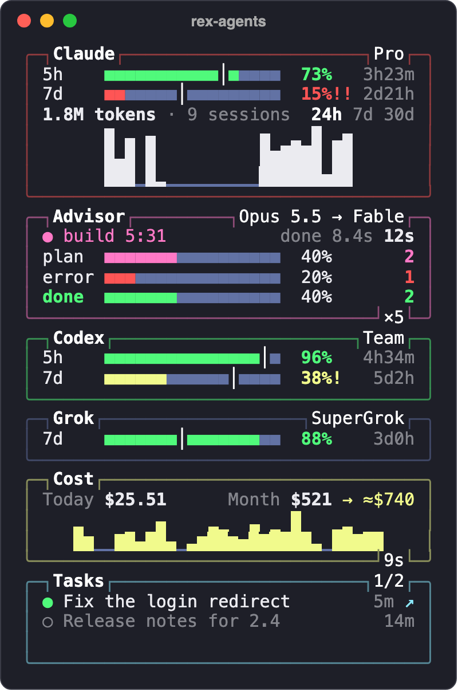

# rex-agents

English | [简体中文](README.zh-CN.md)

A side panel for the [Rex](https://www.superlogical.com/rex) terminal: how much quota Claude Code, Codex and Grok have left and when it resets, the advisor of the Claude Code sessions in the tab, today's and this month's cost, and the agents running. It opens down the right edge of any tab, beside any agent or none.



It needs Python 3.11 or later and [uv](https://docs.astral.sh/uv/). The data comes from [agents-meter](https://github.com/iskerwin/agents-meter), a standard-library-only library `uv` installs with it.

## Install

```bash
git clone https://github.com/iskerwin/rex-agents ~/Developer/rex-agents
cd ~/Developer/rex-agents
uv tool install .            # after a code change: uv tool install --force --reinstall .
```

Then load the plugin from Rex's config, `~/.config/rex/init.lua`, with the absolute path of the command `uv tool install` put on your PATH (`which rex-agents`):

```lua
dofile("/Users/you/Developer/rex-agents/rex/init.lua").setup({ bin = { "/Users/you/.local/bin/rex-agents" } })
```

Run `rex config reload`. Shift+Cmd+U, or "Toggle Agents Panel" in the command palette, opens or closes the panel in the current tab. `setup` also takes:

| Option | Default | |
|---|---|---|
| `width` | `1/3` | The panel's share of the tab's width, such as `1/4` |
| `key` | `"shift+cmd+u"` | The toggle's key; `false` binds none |
| `bin` | `{ "rex-agents" }` | The command, as a list |

The panel shows this machine's agents, so it opens only in sessions on this machine.

## The panel

- **One box per agent**, a row per quota window: a meter of what is left, the share left and the time to the reset. The bright notch is where an even pace would be now. `!` marks 40% or less left, `!!` 20% or less. The title carries the plan, and the workspace where there is one; a stale account's foot says how old its data is, such as `stale 3h`.
- **Usage trend**, in the box of each agent running in the tab: tokens per hour over the last 24 hours, or per day over the last 7 or 30 days, with the total and how many sessions it spans. Cache reads are left out: every turn rereads the whole context, so they would swamp what the turns added. Click `24h`, `7d` or `30d`, or press `1`, `2` or `3` in the panel, to switch. The panel takes mouse clicks, so selecting its text needs Option-drag.
- **Advisor**, under Claude's box while a Claude Code session in the tab has an advisor: the main model and the advisor, whether the main model is working, how long ago the advisor last answered, and how many calls fell under each moment it is meant to wake up: before the plan locks, the same error twice, before calling it done, and check-ins between. An advisor set but not called through three working turns reads `idle · N turns`: it is likely less capable than the main model and never activates.
- **Cost**: today's and this month's, estimated at public API prices, where the month lands at its pace so far (`→ ≈$856`), and the cost of each of the last 30 days. The foot says how old the data is.
- **Tasks**: the agents' sessions, `●` running and `○` idle, down to the panel's foot. A session running in a Rex pane ends in `↗`: its row lights under the pointer, and a click goes to its session and tab.

A shorter panel drops the cost chart first, then the trends, then folds to one line per agent. It refreshes every 60 seconds, and opens on the last data it saw, marked `refreshing`, until fresh data arrives. However many panels are open, alongside any other tool using agents-meter, Claude and Grok are asked for their quota once a minute between them all. Press `q` in the panel to quit it.

When a quota window falls to 10% or less, and when a spent one resets, the panel asks Rex for a system notification (OSC 777; Rex's Terminal Notifications setting must be on). The panels share what they have told, so each change is told once, and opening a panel tells nothing.

**Cost is an estimate, not a bill.** Tokens from the logs are priced at [public API rates](https://github.com/iskerwin/agents-meter/blob/main/agents_meter/pricing.py); subscriptions don't pay that way. Models without a public price (such as `grok-4.7-build`) aren't counted, nor are long-context and fast-mode surcharges, so it runs a little under real API cost.

## Where the data comes from

The quotas, tokens, cost and sessions are read by [agents-meter](https://github.com/iskerwin/agents-meter#where-the-data-comes-from): which logs and endpoints, which tokens it reads and where they go, and its rules. Claude's quota comes from the live usage endpoint, with Claude Code's stored token (the macOS keychain may ask once).

Which agents run in the tab is told by the name of the program in front of each pane, as Rex reports it. The advisor box reads the log of each Claude Code session in the tab, found through Rex and `~/.claude/sessions/<pid>.json`: advisor calls, model names, tool names and whether a tool failed, never what was said. A failed result's first 80 characters are compared, in memory only, to tell the same error twice.

## Develop

```bash
uv run --group dev pytest
```

## Notice

Unofficial, and not affiliated with Superlogical, Anthropic, OpenAI or xAI. The Claude and Grok quotas come from undocumented endpoints with the tokens stored on this machine, and may stop working at any time; check that this fits each service's terms before you use it.

The advisor moments follow [advisor-live](https://github.com/iskerwin/advisor-live), a Claude Code mod with a pane of its own.

## License

[MIT](LICENSE)
