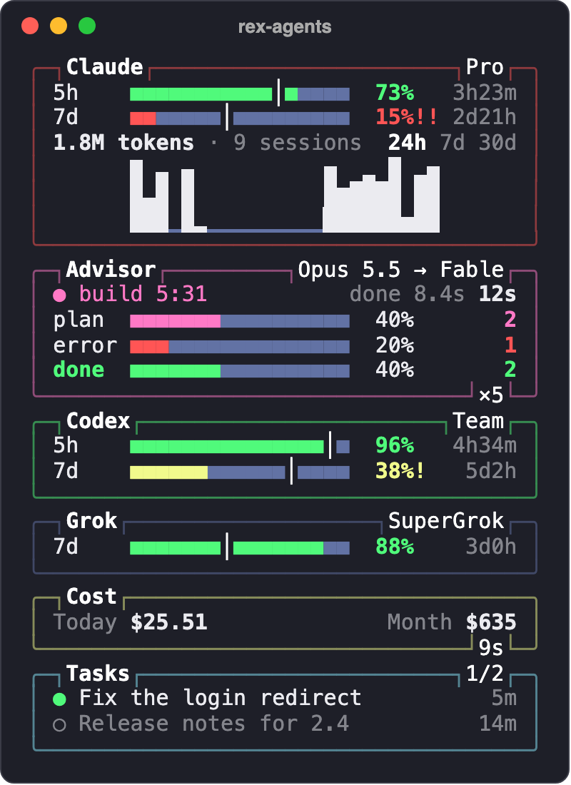

# rex-agents

[English](README.md) | 简体中文

[Rex](https://www.superlogical.com/rex) 终端的侧边面板：Claude Code、Codex 和 Grok 还剩多少额度、什么时候重置，当前标签页里 Claude Code 会话的 advisor，今天和本月的费用，以及正在运行的 agent。它沿任意标签页的右边缘打开，旁边跑什么 agent 都行，不跑也行。



需要 Python 3.11 或更高版本和 [uv](https://docs.astral.sh/uv/)。数据来自 [agents-meter](https://github.com/iskerwin/agents-meter)，一个只用标准库的库，`uv` 会一起安装。

## 安装

```bash
git clone https://github.com/iskerwin/rex-agents ~/Developer/rex-agents
cd ~/Developer/rex-agents
uv tool install .            # 改了代码之后：uv tool install --force --reinstall .
```

然后在 Rex 的配置 `~/.config/rex/init.lua` 中加载插件，`bin` 填 `uv tool install` 装到 PATH 上的命令的绝对路径（`which rex-agents`）：

```lua
dofile("/Users/you/Developer/rex-agents/rex/init.lua").setup({ bin = { "/Users/you/.local/bin/rex-agents" } })
```

运行 `rex config reload`。按 Shift+Cmd+U，或在命令面板中选“Toggle Agents Panel”，在当前标签页打开或关闭面板。`setup` 还接受：

| 选项 | 默认值 | |
|---|---|---|
| `width` | `1/3` | 面板占标签页宽度的比例，例如 `1/4` |
| `key` | `"shift+cmd+u"` | 开关的快捷键；`false` 表示不绑定 |
| `bin` | `{ "rex-agents" }` | 命令，以列表形式给出 |

面板显示的是本机的 agent，所以只在本机的会话里打开。

## 面板

- **每个 agent 一个框**，每个额度窗口一行：剩余量的进度条、剩余比例和距离重置的时间。亮色刻度表示按匀速消耗此刻应在的位置。`!` 表示剩余 40% 或更少，`!!` 表示 20% 或更少。标题上显示套餐，有工作区时也显示工作区。
- **用量趋势**，显示在当前标签页里正在运行的 agent 的框中：最近 24 小时每小时的 token，或最近 7 天、30 天每天的 token，以及合计和涉及的会话数。缓存读取不计入：每个回合都会重读整个上下文，计入会淹没回合本身新增的用量。点击 `24h`、`7d`、`30d`，或在面板里按 `1`、`2`、`3` 切换。面板会接收鼠标点击，所以要选中其中的文字需按住 Option 拖动。
- **Advisor**，当前标签页里有 Claude Code 会话设置了 advisor 时显示在 Claude 框下方：主模型和 advisor，主模型是否在工作，advisor 上次回答是多久以前，以及每个应当介入的时机各有多少次调用：计划定下之前、同一错误出现两次、宣布完成之前，以及其间的 check-in。设置了 advisor 但连续三个工作回合都没被调用时显示 `idle · N turns`：它很可能比主模型弱，永远不会被唤起。
- **Cost**（费用）：今天和本月的费用，按公开 API 价格估算。框底显示数据多久以前更新。
- **Tasks**（任务）：各 agent 的会话，`●` 运行中，`○` 空闲，一直排到面板底部。

面板变矮时先隐藏趋势图，再矮就每个 agent 折叠成一行。每 60 秒刷新一次。无论开了多少个面板，再加上其他使用 agents-meter 的工具，Claude 和 Grok 的额度加起来每分钟只查询一次。在面板里按 `q` 退出。

**费用是估算，不是账单。** 日志中的 token 按[公开 API 价格](https://github.com/iskerwin/agents-meter/blob/main/agents_meter/pricing.py)计价，订阅并不按这种方式付费。没有公开价格的模型（例如 `grok-4.7-build`）不计入，长上下文和 fast mode 的加价也不计入，所以会比实际 API 费用略低。

## 数据来源

额度、token、费用和会话由 [agents-meter](https://github.com/iskerwin/agents-meter/blob/main/README.zh-CN.md#数据来源) 读取：读哪些日志和接口、读哪些 token 以及发往哪里，以及它的规则。Claude 的额度来自实时用量接口，使用 Claude Code 保存的 token（macOS 钥匙串可能会询问一次）。

标签页里运行着哪些 agent，按 Rex 报告的每个窗格前台程序名判断。Advisor 框读取当前标签页里每个 Claude Code 会话的日志，会话通过 Rex 和 `~/.claude/sessions/<pid>.json` 找到：只读 advisor 调用、模型名、工具名以及工具是否失败，从不读取对话内容。失败结果的前 80 个字符只在内存中比较，用来判断是否为同一错误。

## 开发

```bash
uv run --group dev pytest
```

## 声明

非官方项目，与 Superlogical、Anthropic、OpenAI 和 xAI 无关。Claude 和 Grok 的额度来自未公开的接口，使用本机保存的 token，随时可能失效；使用前请确认符合各服务的条款。

Advisor 的时机划分沿用 [advisor-live](https://github.com/iskerwin/advisor-live)，那是一个带有独立窗格的 Claude Code mod。

## 许可证

[MIT](LICENSE)
